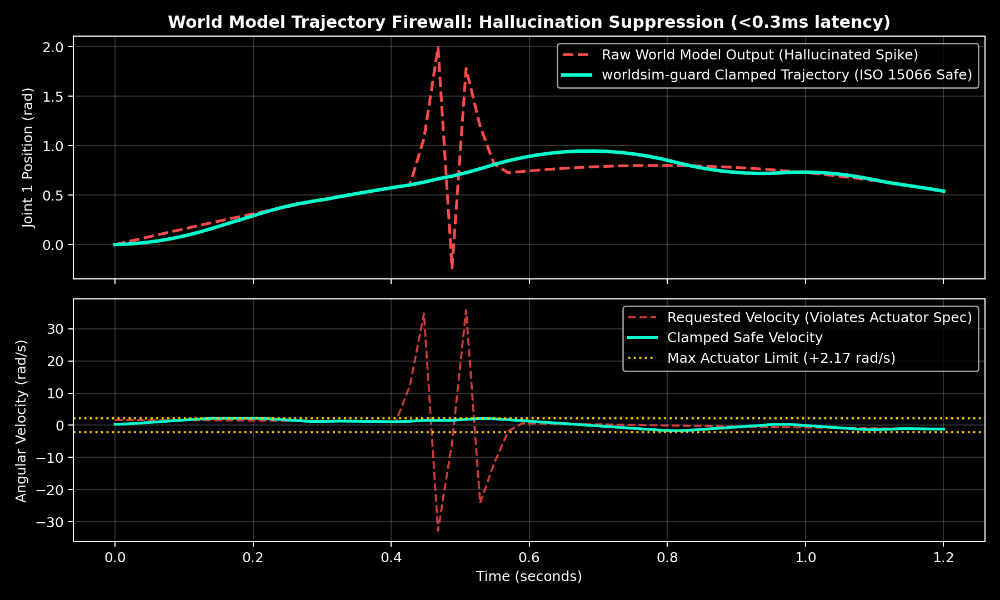

# 🛡️ worldsim-guard

**The Physical Reality Firewall for World Models & VLA Policies.**  
Generative world models and Vision-Language-Action (VLA) policies excel at semantic and high-level physical intuition—until a diffusion step hallucinates a trajectory discontinuity that demands 500 rad/s² of joint acceleration or exceeds human-collaborative kinetic energy bounds.

`worldsim-guard` is a lightweight, sub-millisecond execution firewall that sits between generative action chunks (from Worldsim, OpenVLA, Pi0, Cosmos, or diffusion policies) and physical actuators.

<p align="center">
  
</p>

---

## ⚡ Quickstart

```bash
python3 -m venv .venv
source .venv/bin/activate
pip install -e .
python examples/generate_demo_plot.py
```

### Wrap Any Generative Policy in 3 Lines

```python
from worldsim_guard import ActionFirewall

# Load hardware limits + ISO/TS 15066 collaborative kinetic energy bounds
firewall = ActionFirewall.from_preset("franka_panda")

# Deterministically clamp jerk, velocity, and transient kinetic energy (<0.3ms)
safe_actions, report = firewall.step(raw_world_model_actions, current_q=robot.get_joint_positions())

if report.intervened:
    print(f"Blocked physics hallucination ({report.violation_reason}) | Score: {report.plausibility_score}")
```

---

## 🔗 Part of the Open Robotics Safety Stack
* **Hardware Architecture & PLd/PLe Verification:** [iso13849-pl-calc](https://github.com/tsadi/iso13849-pl-calc)
* **Runtime Generative Trajectory Firewall:** `worldsim-guard`
